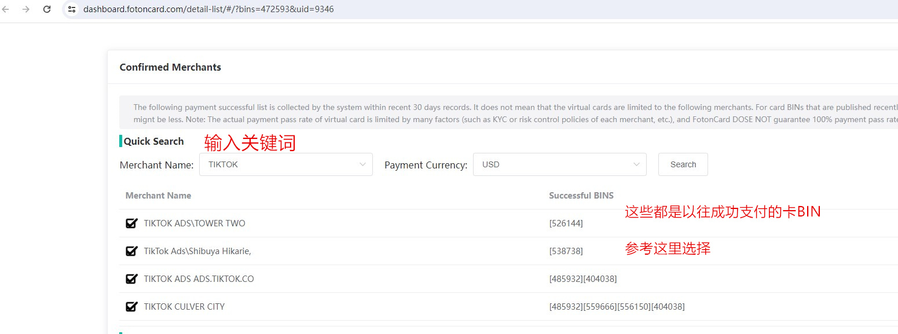

# FotonCard虚拟信用卡怎么样？虚拟卡在线开卡与充值指南（2026）

FotonCard 提供万事达和 Visa 虚拟卡自助开卡服务，面向跨境电商、广告营销和企业出海等线上支付需求。平台与多家银行及发卡机构合作，支持用户根据业务场景选择卡片并管理充值、交易等操作。实际可用功能、申请条件及费用请以注册后的平台页面说明为准。

## 目录

- [可选卡 BIN](#可选卡-bin)
- [注册开户](#注册开户)
- [充值与开卡](#充值与开卡)
- [商户查询](#商户查询)
- [用卡规范](#用卡规范)
- [常见问题与平台说明](#常见问题与平台说明)

## 注册开户

前往 [FotonCard 注册页面](https://dashboard.fotoncard.com/#/pages/register?agent=388832) 创建账户。通过此链接进入注册时会附带邀请码 388832；请按页面提示填写并核对注册信息。

[立即注册 FotonCard](https://dashboard.fotoncard.com/#/pages/register?agent=388832)

## 充值与开卡

账户注册完成后，通常需要先充值再创建卡片。平台页面可能提供多种充值方式，例如企业国际电汇或 USDT 充值；到账时间会因方式及审核流程而异，请以账户内显示的说明为准。

文档所示首次充值建议为 125 美元，实际最低充值金额及手续费请以平台当前规则为准。平台还可能要求新用户缴纳 100 美元保证金；文档说明在满足拒付率、退款率等条件时，保证金预计于 45 天后退回账户余额。缴纳前请在开卡页面仔细确认适用条件、退还规则和相关费用。

完成所需充值及保证金操作后，可选择可用卡 BIN、输入开卡金额并按页面提示创建卡片。文档列出的卡 BIN 示例包括香港地区的 436797、472593、557271、222934、222929、529587、538738、526144、418122 和 471969；美国地区的 485932、531993、553370、404038、441112、524897、556150、559666、428837、540524、556766、556371 和 559292；以及新加坡地区的 450306。平台卡 BIN 会根据业务情况不定期调整，实际库存、开卡权限及适用地区以账户内显示为准。开卡费、充值手续费和其他费用也以平台实时展示为准。

## 商户查询

如果不确定某个卡 BIN 是否适合业务场景，可使用平台的 “Confirmed Merchants” 功能查询历史商户支付记录。例如搜索 “TikTok”，可查看哪些卡 BIN 曾有用户在该商户成功支付，并将结果作为选择参考。

查询记录基于过往用户支付情况，只能作为参考，不保证特定卡 BIN 在某商户一定能够支付成功。没有查询结果也不代表该卡 BIN 一定不适用；商户、发卡机构及支付环节等因素都可能影响交易结果。

创建成功后，可在账户中查看卡号、有效期和安全码等卡片信息，并按卡片规则用于线上支付。文档所列卡片有效期通常为两年；账户还可能支持充值、删除卡片、查看交易明细及 3DS 验证码等功能，具体以当前页面为准。

平台页面右上角提供在线客服入口，可通过该入口咨询账户、卡片或充值相关问题。

## 用卡规范

虚拟卡可用于跨境电商支付、Facebook、Google 或 TikTok 广告投放、营销工具订阅、OTA 航旅预订、企业海外采购等合规线上支付场景。请勿用于高拒付率或高退款率业务，也不得用于违反平台条款或当地法律法规的活动。使用前请确认商户和发卡机构的相关规则。

## 常见问题与平台说明

**如何选择卡 BIN？** 可结合业务所在地、商户要求以及平台的历史商户查询结果进行判断；查询结果并非支付成功保证。

**充值、保证金和开卡费用是多少？** 费用及适用条件可能调整，请以账户内当前展示的规则为准，并在操作前确认退款或退还条件。

**如何联系客服？** 登录平台后，可通过页面右上角的在线客服入口联系支持团队。

**使用时需要注意什么？** 本文信息仅供参考，不构成支付成功、卡片可用性或服务持续性的保证。平台规则可能变化，请以注册后的官方页面及客服确认为准，并遵守相关法律法规及平台条款。

[前往 FotonCard 注册页面](https://dashboard.fotoncard.com/#/pages/register?agent=388832)
